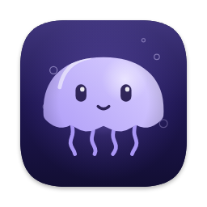
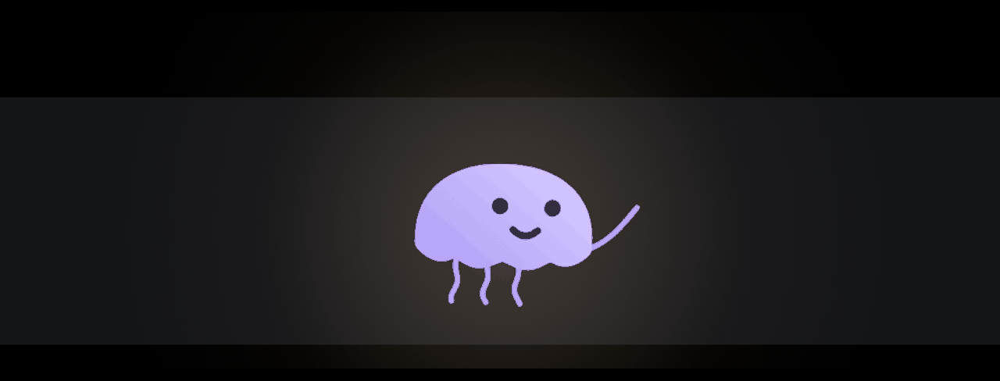

<div align="center">



# Lumo

**A notch companion for Claude Code power users.** Watch every session, approve from the notch
(or your phone), see the diff Claude is about to write, and chat or code with your own little character —
using your Claude Code subscription, no API key needed. On macOS, Windows and Linux.


[](https://github.com/rouderz/coucou/actions/workflows/build.yml)
[](https://github.com/rouderz/coucou/actions/workflows/desktop.yml)



</div>

> **Lumo** started as a fork of [Coucou](https://github.com/Louis-CFM/coucou) by Louis Raillé, whose code it
> uses under the MIT License. It is now its own app by Wolfgang Welcomez (rouderz), with its own name, characters,
> icon, sounds and images — nothing of Coucou's brand (its name, Mochi, its icon, sounds or media) is shipped.
> Lumo is not made or endorsed by Louis Raillé. Some internal identifiers keep their old names (bundle id, data
> folders, the `coucou-hook` relay) so existing installs keep their settings and permissions.

---

## Platforms

| | App | Where the island lives |
|---|---|---|
| **macOS 15+** | native Swift / SwiftUI, in [`NotchBuddy/`](NotchBuddy) | in the notch (or a notch-shaped island on Macs without one) |
| **Windows 10/11** | Tauri 2 (Rust + TypeScript), in [`windows/`](windows) | top centre of the screen; a small notch stays there when it hides |
| **Linux** | the same Tauri app — X11, and Wayland through layer-shell | same as Windows |

Both apps have the same features unless the list below says otherwise; [`windows/README.md`](windows/README.md)
has the details for Windows and Linux.

## What this fork adds

**Claude Code**
- **Several sessions at once** — one chip per project, coloured by state; approvals queue instead of cancelling each other.
- **Live view** — the file Claude is changing, as a diff, with its steps; approve right under the diff.
- **Session timeline** — prompts, files read, edits, commands and approvals with times and durations; copy as Markdown.
- **Safer approvals** — risk colours (red for `rm -r`, force-push, `curl | sh`…), "Always…" shows the exact rule before saving it, ⌥⏎ / ⌥⌫ from the keyboard (never ⌥⏎ on high risk).
- **Auto-approve per project** — let low (or low and medium) risk requests through on their own; high risk always asks.
- **Codex CLI** sessions alongside Claude Code.
- **Phone alerts** — approvals that wait while you're away go to your phone through [ntfy](https://ntfy.sh).
- **Plan usage** — 5-hour and weekly limits like claude.ai, plus the context window of the running session.

**Your character**
- **Five original characters** — Lumo 🪼 (the main one), Bao 🥟, Pip 🌱, Nube ☁️ and Tecla ⌨️, each with its own shape, colours, face and expressions. Pick one in Settings → Characters; the UI, the launch greeting (Lumo waves a tentacle) and the wake word ("Hey Lumo") use its name.
- **Your team** (Settings → Characters) — give Gmail, WhaTicket, GitHub or any integration its own character; the same one twice gets a colour of its own. Each appears in the island's **character rail** with its own base and its own chat about what it handles: WhaTicket's shows today hour by hour, GitHub's your latest repositories. Only the main character has Chat and Code.
- **Notch or free** — keep the characters in the notch, or let them float anywhere on the screen (all of them, or just the main one): drag one, click it and the island pops out under it; each reacts to its own clicks. They sit on top of the Settings window while it's open. Right-click for the menu.
- **Drop a file** — the character catches it and reads it (Lumo holds it with two tentacles), then offers to answer questions about it.
- **Smaller folded notch** — a status dot and a count instead of the grid.

**Chat and Code**
- **Two modes, one switch** — the segmented *Chat / Code* control in the island header (⌥⌘← / ⌥⌘→ on Mac, Ctrl+Alt+← / → on Windows and Linux). Each mode keeps its own conversation.
- **Code** — Claude Code working in a folder you pick, right in the island — no terminal: *Start* on the main base begins. Folders kept at hand are one click away, and Claude Code can read all of them. It reads and searches the project; with *Edits on* it changes files and runs commands, each one approved in the island.
- **VPN** — a chip on the main base shows whether your VPN is on and turns it on or off: the VPNs the system knows (Proton VPN, WireGuard / NetworkManager on Linux, Windows VPN connections) and Cloudflare WARP. With none it points to Proton VPN's free plan.
- **Chat with your Claude Code subscription** (no API key), or an Anthropic API key with streaming and clear errors. Model picker: Opus 5.5 by default.
  On Windows and Linux the chat can also use OpenAI, Gemini, OpenRouter, Ollama, LM Studio or any OpenAI-compatible server.
- **Ask about the file you're editing** (⌃⌥M) in Chat — reads the project, never edits unless you turn on "Edits on"; every change is approved in the island.
- **Editor extension** for VS Code, Cursor, Windsurf and VSCodium — exact file, cursor, selection and errors. See [`extensions/vscode`](extensions/vscode).
- **Push-to-talk** (hold ⌃⌥V) — speak, your character answers and reads it aloud. On-device transcription when the Mac supports it.
  Windows: the 🎙 in the chat. Linux: replies read aloud only (no built-in speech recognition).
- **Chat history** — the last 50 conversations, resumable.
- **Skills** — Settings → Skills lists every Claude Code / Codex skill on the computer (personal, per project, from plugins), turns them off without deleting, and installs new ones from a folder, a zip or a GitHub link after showing what's inside. `/` in the chat picks one.
- **Google Drive in the chat** — `@` and a file name attaches a Doc (as text), a Sheet (as CSV), Slides or any file.

**Work apps**
- **WhaTicket** — the WhatsApp ticket queue and your tickets in the island, Accept in one click, and optional auto-accept (by queue and hours). It works through a small Chrome / Edge extension ([`extensions/whaticket`](extensions/whaticket)) that uses the whaticket.com session you already have open — no token, no admin access. Set it up from Settings → WhaTicket. Stats there count the tickets that arrived and the ones you accepted (by click, auto-accept or elsewhere), with waits, per hour, day and queue, and CSV export — kept locally for a year, ticket ids and queues only.
- **AliExpress** — your orders grouped by the box they ship in (same tracking number), with one PDF invoice per box and a CSV of every product for Excel or Google Sheets, saved to Downloads/Lumo/AliExpress. Its own small Chrome / Edge extension, Lumo for AliExpress ([`extensions/aliexpress`](extensions/aliexpress)), reads your own order pages with the session you already have open; Lumo never calls AliExpress. Set it up from Settings → AliExpress. The invoice is your own document: it cites the AliExpress order numbers and says it isn't issued by AliExpress. Buyer details for the invoice live in the Keychain / credential store (Settings → AliExpress).
- **Gmail** — what matches your search (unread in the inbox by default); "Ask" hands a mail to the chat. Read-only, with your own Google Cloud OAuth client.

**Everyday**
- **Do not disturb** — 🌙 in the island, or automatically during calendar events (calendar: macOS only).
- **Inbox** — 🔔 GitHub and Linear notifications that need you; the Linear issue your branch names, on the session card.
- **Updates itself** — downloads the new version, checks its signature, installs and restarts.
- **Spanish and English** interface.
- **GitHub through your `gh` login**, any editor for "Open in…", status lights and refresh on every integration.
- **Lighter** — the island idles at ~0.2 % CPU; integrations poll less when hidden, stop when the screen is locked and back off on errors.

## Install

**Download:** every release on the [Releases](https://github.com/rouderz/coucou/releases) page has all three:

| | File | First launch (not code-signed yet) |
|---|---|---|
| macOS | `Lumo-<version>-macOS.dmg` — drag Lumo to Applications | System Settings → Privacy & Security → **Open Anyway** |
| Windows | `Lumo-<version>-Windows-setup.exe` | SmartScreen → **More info → Run anyway** |
| Linux | `.deb`, `.rpm` or `.AppImage`, x86_64 and arm64 | — |

Lumo for Mac checks for new releases itself (Settings → Updates). To try a build without releasing, run the
[Release workflow](https://github.com/rouderz/coucou/actions/workflows/release.yml) by hand: the files stay on the run as artifacts.

Builds aren't code-signed yet (#38, #39), hence the warnings on first launch.

**Updates itself:** Lumo installs new versions by itself and restarts (Mac: Settings → Updates →
*Install and restart*; Windows and the Linux AppImage: the ⬇ in the island). Every download is checked
against Lumo's signing key first. `.deb` / `.rpm` installs and copies the user can't write to fall back
to downloading the new package.

## Releasing

| Command | Does |
|---|---|
| `bash scripts/release.sh 0.3.0` | sets the version in every platform's files, tags `v0.3.0` and pushes; the [Release workflow](.github/workflows/release.yml) builds macOS, Windows and Linux (x86_64 and arm64), signs the updates and publishes one GitHub release with everything plus `latest.json` |
| `bash scripts/versions.sh` | shows the version in each file; `set X.Y.Z` / `check` |
| `bash scripts/build.sh` | builds for the system you're on, into `dist/` |
| `bash scripts/updater-keys.sh` | one-time: creates the update signing keys and stores the private ones as GitHub secrets (`MAC_UPDATE_KEY`, `TAURI_SIGNING_PRIVATE_KEY`); only the public keys are in the code |

Builds only run on version tags, or by hand from the Actions tab (pick the platforms; nothing is published).
Pull requests run the tests: [`build.yml`](.github/workflows/build.yml) for macOS,
[`desktop.yml`](.github/workflows/desktop.yml) for Windows and Linux.

## Build from source

**macOS** — macOS 15+, Xcode 16+ (Xcode 27 works), [XcodeGen](https://github.com/yonaskolb/XcodeGen), and
[Claude Code](https://docs.claude.com/en/docs/claude-code) signed in for the subscription chat.

```bash
brew install xcodegen
git clone https://github.com/rouderz/coucou.git
cd coucou/NotchBuddy
xcodegen
xcodebuild -scheme NotchBuddy -configuration Debug build
open "$(xcodebuild -scheme NotchBuddy -configuration Debug -showBuildSettings | awk '/ BUILT_PRODUCTS_DIR /{print $3}')/Lumo.app"
```

Run `xcodegen` again whenever files are added or after pulling — otherwise Xcode reports "cannot find … in scope" for the new files. Tests: `xcodebuild test -scheme NotchBuddy -destination 'platform=macOS'`.

**Windows and Linux** — [Rust](https://rustup.rs) and [Node 20+](https://nodejs.org); on Windows the MSVC build
tools, on Linux the WebKitGTK packages listed in [`windows/README.md`](windows/README.md#linux).

```bash
cd coucou/windows
npm install
npm run tauri dev      # development build
npx tauri build        # installer (Windows) or .deb / .rpm / .AppImage (Linux)
```

Tests: `npm test` (front end) and `cargo test` (Rust).

## Setup

Menu bar icon (Mac) or tray icon (Windows, Linux) → **Settings…**

| What | Why |
|---|---|
| **Claude Code Hooks → Install / Update hooks** | live sessions, approvals and plan usage. Lumo backs up `~/.claude/settings.json` and shows the diff first. |
| **Chat → Engine** | *Claude Code (subscription)* needs nothing else; *Anthropic API key* goes to the Keychain. |
| **Character** | pick the character, give integrations their own, choose notch or free placement. |
| **Hotkey** | ⌃⌥M ask about the file · ⌃⌥V push-to-talk · ⌥⏎ / ⌥⌫ approvals. Grant Accessibility for ⌃⌥M (Mac). |
| **Auto-approve · Phone alerts · Do not disturb** | optional, all off by default. |
| **Integrations** | GitHub (uses `gh` if signed in), Linear, Vercel, Stripe, Resend, n8n, Notion, Cal.com, WhaTicket, AliExpress — all optional. |
| **Google** | Gmail and Drive: create a free "Desktop app" OAuth client in Google Cloud, paste it, Connect. |
| **General → Idle notch** | Windows / Linux: the small notch left at the top when the island hides; turn it off to leave only an invisible strip. |

If Lumo isn't running, the hook exits at once: **Claude Code is never blocked.**

## Shortcuts

| Mac | Windows / Linux | Does |
|---|---|---|
| ⌃⌥M | — (use the editor extension's "Ask Lumo about this") | ask about the file in the front editor (with the extension: exact cursor, selection and errors) |
| hold ⌃⌥V | 🎙 in the chat (Windows) | push-to-talk |
| ⌥⏎ / ⌥⌫ | Alt+Enter / Alt+Backspace (X11 only on Linux) | allow / deny the waiting approval (only while one is waiting) |
| ⌥⌘← / ⌥⌘→ | Ctrl+Alt+← / → | switch between Chat and Code |
| Esc | Esc | close the island |

## Privacy

No telemetry, no account. Keys live in the macOS Keychain, the Windows Credential Manager or the Linux
Secret Service (GNOME Keyring, KWallet) — never on disk. Lumo talks only to the services you configure, plus:

- Anthropic (`api.anthropic.com`) with your Claude Code login, to read plan usage;
- your ntfy server, if you turn on phone alerts (it receives the project and the command — keep the topic private);
- GitHub (`api.github.com`, `github.com`), to check for and download updates — turn it off in Settings → Updates;
- GitHub again only when you paste a link to install a skill from it;
- Google's APIs (Gmail, Drive), only if you connect them. WhaTicket and AliExpress are read by the browser extension in your own tab; Lumo itself never calls it.

The editor extension talks to Lumo over a local socket (named pipe on Windows) only.

## How it works

**macOS** (`NotchBuddy/`)
- **Island**: a borderless `NSPanel` hugging the notch, driven by a small state machine.
- **Claude Code**: the `nb-hook` script forwards hook events over a Unix socket; for approvals it waits for your answer. A status line script forwards plan usage and context.
- **Chat**: `claude -p --output-format stream-json` with your subscription (or the Messages API with streaming and prompt caching).
- **Views** live in `NotchBuddy/Sources/App/Views/`; tests in `NotchBuddy/Tests/`.
- **Characters** are drawn in code (`Bot/Critter.swift`, `Canvas` + `TimelineView`) — no images.
- Native Swift 6 / SwiftUI / AppKit, **no third-party dependencies**.

**Windows and Linux** (`windows/`)
- **Island**: a transparent, always-on-top Tauri window at the top centre (a layer-shell surface on Wayland); the characters are drawn in Canvas 2D like on the Mac.
- **Claude Code / Codex**: `coucou-hook` relays hook events over a named pipe (Windows) or a `0600` Unix socket (Linux), and exits at once if Lumo isn't there.
- **Backend** in Rust (`windows/src-tauri/`), front end in TypeScript with no framework (`windows/src/`).
- What differs between Windows and Linux lives in `windows/src-tauri/src/platform/`.

## License and copyright

Lumo has three kinds of content, each with its own owner and terms (summed up in [NOTICE](NOTICE)):

| What | Copyright | License | Details |
|---|---|---|---|
| **Source code** — the macOS, Windows and Linux apps, the hook relays, the scripts, the editor and browser extensions | © 2026 Louis Raillé (original Coucou code) · © 2026 Wolfgang Welcomez (rouderz) (Lumo's changes and new code) | [MIT](LICENSE) | Use, change and share it, keeping both copyright notices and the license text. |
| **Characters** — Lumo, Bao, Pip, Nube and Tecla: their names as characters, designs, palettes, faces, expressions and animations | © 2026 Wolfgang Welcomez (rouderz) | [CC BY 4.0](https://creativecommons.org/licenses/by/4.0/) | Share and adapt them, commercially too, **with credit**: *"Lumo, Bao, Pip, Nube and Tecla © Wolfgang Welcomez (rouderz), CC BY 4.0"*. See [LICENSE-CHARACTERS.md](LICENSE-CHARACTERS.md). The code that draws them is MIT. |
| **Brand and media** — the name "Lumo" as an app, the app and menu bar icons (`windows/dev/icon.html`), the sounds (`scripts/gen-sounds.py`), the images and GIFs in `docs/media/`, `design/` and `windows/screenshots/` | © 2026 Wolfgang Welcomez (rouderz) | All rights reserved | See [LICENSE-ASSETS.md](LICENSE-ASSETS.md). Running and forking Lumo is fine; publishing another app needs its own name, icon and sounds. |

**Coucou.** The name "Coucou", the Mochi character and Coucou's icon, sounds and media belong to Louis Raillé
([his terms](https://github.com/Louis-CFM/coucou/blob/main/LICENSE-ASSETS.md)). They are not part of Lumo; older
commits in this repository still contain them under his terms.

**Third-party code.** The macOS app has no dependencies. The Windows and Linux builds include open-source
libraries — Tauri and its plugins, the `windows` crate, GTK / WebKitGTK bindings and the others listed in
[`windows/Cargo.lock`](windows/Cargo.lock) and [`windows/package-lock.json`](windows/package-lock.json) — each
under its own license (mostly MIT and/or Apache-2.0); their notices apply to the binaries you download.

**Trademarks.** Claude and Claude Code are Anthropic's; GitHub, Linear, Gmail, Google Drive, WhaTicket,
AliExpress, Proton VPN, Cloudflare WARP, Visual Studio Code and the other services Lumo connects to belong to
their owners. Lumo is not affiliated with or endorsed by any of them.

Lumo: by Wolfgang Welcomez (rouderz). Based on [Coucou](https://github.com/Louis-CFM/coucou), built by [Louis Raillé](https://louisraille.fr) with Claude Code.
